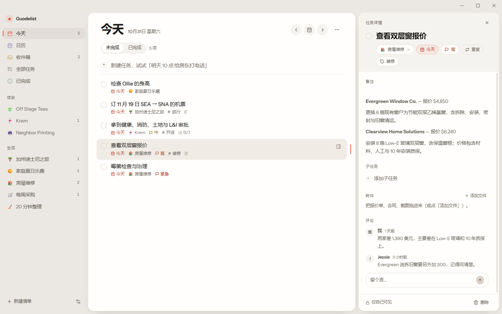
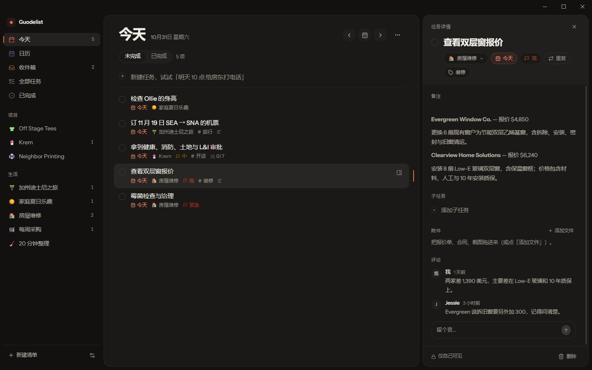
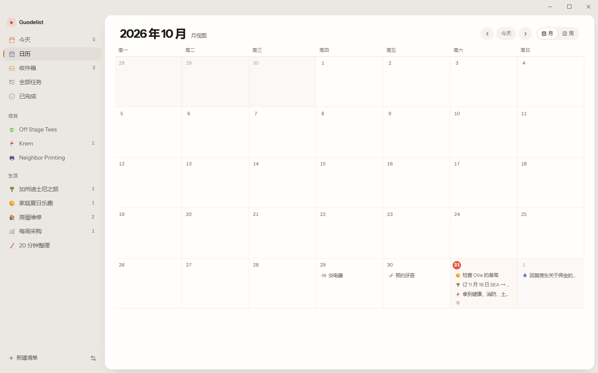
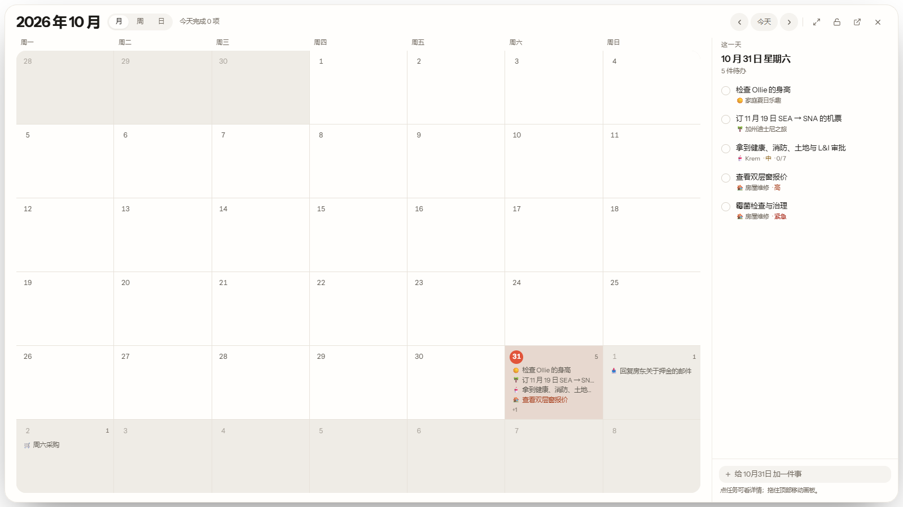

# Guodelist

> Superlist 风格的桌面待办应用 — Tauri 2 + React 19 + shadcn/ui



Guodelist 用 Tauri + React 复刻了 [Superlist](https://www.superlist.com/) 的界面语言：暖灰画布、米白面板、朱红强调色、三栏结构，以及「任务即文档」的详情面板。v0.3 补齐了笔记、附件、重复任务、日历视图、明暗主题、可调宽的三栏和**桌面小组件**，AI 相关能力（会议笔记、语音、MCP）仍未实现。

| 深色模式 | 日历视图 | 桌面小组件 |
| --- | --- | --- |
|  |  |  |

## 安卓端

同一后端、同一份任务。安卓客户端用 Kotlin + Jetpack Compose 重写，离线优先、双向同步、中英双语：
`guodelist-android` 仓库（APK 见该仓库的 Releases）。

## 服务端

Express 4 同步 API + 管理后台 + Android/Windows 安装包托管，代码在 [`server/`](server/)。
部署后管理员入口为 `https://api.example.com/admin`（替换成你的域名）；`server/README.md` 说明配置。

## 客户端更新

桌面端设置 → 数据 → 软件更新会请求 `/api/v1/app/latest?platform=windows`，下载服务器上的
NSIS 安装包、校验 SHA-256 后自动启动安装器；Android 使用同一个版本接口和 `/downloads/android/…`。

## 开发与发布

改版本号、构建 Windows/Android 安装包、上传到服务器更新源、发布 GitHub Release 的完整清单：
[docs/RELEASING.md](docs/RELEASING.md)。

管理后台：`https://api.example.com/admin`（替换成你的域名，需要管理员账号）。

## 功能

**任务**
- 快速新建：`明天 10 点 交房租`、`周五 交房租`、`5月20日`、`tomorrow 3pm` 自动解析日期时间
- 勾选完成、优先级、截止日期/时间、标签、备注、子任务、附件、任务内评论
- **重复任务**：每天 / 每个工作日 / 每周（按星期几）/ 每月；勾选完成后自动滚出下一次
- **拖拽排序**：按住任务上下拖动即可调整顺序（同一日期内）
- 移动到其它清单、删除任务、已完成视图

**笔记（所见即所得 Markdown）**
- 基于 [Tiptap](https://github.com/ueberdosis/tiptap) 3 + `tiptap-markdown`，输入 `# `、`- `、`> `、`**粗体**` 等 Markdown 语法即时渲染
- 悬浮出现的轻量工具条：粗体、斜体、删除线、列表、待办列表、引用、行内代码、链接
- 内容以 Markdown 字符串存进任务，导出 JSON 时也是可读的 Markdown

**附件**
- 桌面端：文件选择器 → 复制到应用数据目录 `attachments/`，点击用系统默认程序打开
- 浏览器预览：内联为 data URL（限 2 MB）

**日历**
- 主窗口有 月 / 周 / 日 三种视图
- **月**：6 周网格，今天高亮，任务落在日期格子里；点日期跳到当天列表，双击进日视图
- **周**：带小时刻度的时间网格（和桌面画板同一套逻辑）——按开始/结束时间画块、重叠自动分栏、今天整列淡红 + 当前时间红线；窗口变窄时**横向滚动**而不是压缩列宽，展开详情也只会滚动，不会把列挤变形
- **日**：当天议程，左列时间、右侧任务、清单色点

**托盘常驻**
- 关掉主窗口不退出：窗口隐藏到系统托盘，应用继续运行（提醒继续生效）
- 托盘图标左键单击打开主窗口；右键菜单：打开 Guodelist / 新建任务… / 显示或隐藏桌面画板 / 退出
- 「新建任务…」会唤起窗口并把光标放进快速添加框
- 只有托盘菜单里的「退出 Guodelist」才会真正结束进程

**任务右键菜单**
- 右键任意任务：打开详情 / 标记完成 / 归档 / 复制标题 / 删除
- 归档只是隐藏，不删数据；可在 设置 → 数据与关于 → 「恢复已归档任务」一键放回

**提醒与通知**
- 每条任务可选「准时 / 提前 5·15·30 分钟 / 提前 1 小时 / 提前 1 天」提醒；设置里可改默认提前量
- 到点用系统桌面通知（Tauri notification 插件，网页预览回退到 Web Notification）
- 提醒触发后写入 `notifiedAt` 去重，重启不会重复弹；只在应用运行时生效

**外观与布局**
- 浅色 / 深色 / 跟随系统，设置里可切换
- **账号与同步**：设置 → 账号与同步，可注册/登录你配置的 API 服务（`VITE_API_BASE`）；不登录时数据只在本机，登录后本机与云端双向同步（按 `updatedAt` 最后写入者胜出，删除用墓碑记录，冲突不会丢数据）。同步时机：本地改动 2.5 秒后推送、每 60 秒拉取、窗口聚焦/联网时拉取
- **主题风格**：经典（暖灰 + 朱红）/ **星星人**（奶油云朵 + 糖果色，星星人吉祥物出现在标题栏、日历头部和角落，事件色块换成糖果粉彩）
- 界面字号 90% / 100% / 110% / 120%
- **三栏可拖拽调宽**，双击分隔线恢复默认
- 窗口按钮按平台走：Windows 右上角最小化/最大化/关闭（关闭按钮 hover 变红），macOS 左上角交通灯

**桌面日历（横屏大画板）**
- 桌面版提供一块 **1600×900 的横屏日历画板**（按屏幕自适应），无边框、无标题栏、无任务栏图标，也不进 Alt+Tab；透明底 + 半透明面板，铺在桌面上时看起来就是壁纸的一部分
- 窗口 `alwaysOnBottom`：不抢焦点、不挡普通窗口，`Win+D` 回到桌面就能看到
- **月 / 周 / 日 三种视图**：月视图是整月网格；周视图参考苹果日历——左侧小时刻度、顶部「全天」行、任务按**开始–结束时间**画成不同高度的色块，重叠时自动分栏；今天整列淡红并带当前时间线；日视图是当天议程
- 右上角尺寸菜单：**紧凑 / 标准 / 铺满桌面**，直接改窗口大小（「铺满」就是 1920×1080 这种整屏）；设置里还能调**画板透明度**（30%–100%），越小壁纸越透出来
- 主窗口永远在画板之上：画板每次拿到焦点都会重新压回桌面层（`widget_sink`）
- 点任意任务打开**详情弹窗**：改标题、清单、日期时间、优先级、重复、标签、备注（富文本）、子任务，改完立刻同步主窗口；日期弹层里直接选开始/结束时间（30 分钟、1 小时、2 小时快捷），不再需要额外的「时间段」按钮
- **锁定按钮**：一键只读——勾选、添加、删除、编辑全部禁用，仍然可以点开详情查看
- 月视图每格悬停出现 `+`，直接给那天加任务；周/日视图底部有添加框
- 与主窗口共用同一份数据（`storage` 事件 + zustand rehydrate）
- 设置 → 桌面 → 开关；关闭后下次启动不再自动出现

**其它**
- 侧边栏清单支持右键菜单：重命名、更换图标、移动到分组、复制清单、删除清单
- 命令面板（`⌘/Ctrl K`）：跳转视图/清单、搜索任务、新建任务
- 数据存本机（localStorage），设置里可导出 JSON / 重置演示数据
- **今天严格只显示今天**：逾期任务保留在「全部任务」；清单/任务同步基于 `updatedAt` + 墓碑合并，详见
  [docs/SYNC.md](docs/SYNC.md)
- 单元测试：`pnpm test`，覆盖率门禁：`pnpm test:coverage`

## 技术栈

| 层 | 选择 |
|---|---|
| 桌面壳 | Tauri 2（Rust / WebView2） |
| 前端 | React 19 + TypeScript + Vite 7 |
| 样式 | Tailwind CSS 4 + shadcn/ui |
| 编辑器 | Tiptap 3 + tiptap-markdown |
| 拖拽 | dnd-kit |
| 状态 | zustand（persist） |
| 其它 | date-fns、lucide-react、Instrument Sans |

## 开发

前置：Node 22+、pnpm 10+、Rust（rustup + MSVC 工具链）、WebView2。

客户端 API 地址通过 `VITE_API_BASE` 配置（默认是占位地址 `https://api.example.com`），
不要在源码里写死生产域名。更新默认从 GitHub Releases 读取，可通过 `VITE_GITHUB_REPO`
指向你的仓库（默认 `TankNee/guodelist`）：

```bash
VITE_API_BASE=https://api.your-server.example \
VITE_GITHUB_REPO=TankNee/guodelist \
pnpm tauri build
```

```bash
pnpm install
pnpm dev          # 浏览器 http://localhost:5173
pnpm tauri dev    # 桌面窗口
```

## 构建

```bash
pnpm tauri build
```

产物：

- `src-tauri/target/release/bundle/nsis/Guodelist_0.3.3_x64-setup.exe`
- `src-tauri/target/release/bundle/msi/Guodelist_0.3.3_x64_en-US.msi`

## 快捷键

| 快捷键 | 作用 |
|---|---|
| `⌘/Ctrl K` | 命令面板 |
| `⌘/Ctrl N` | 新建任务 |
| `⌘/Ctrl ,` | 设置 |
| `⌘/Ctrl Enter` | 完成选中任务 |
| `↑` / `↓` | 切换任务 |
| `Esc` | 关闭详情 / 弹层 |

## 目录

```
src/
  components/app/      侧栏、列表、任务行、详情、日历、命令面板、富文本、设置
  components/ui/       shadcn/ui 基础组件
  data/seed.ts         演示数据
  lib/date.ts          自然语言日期解析
  lib/recurrence.ts    重复任务的下一次日期
  lib/attachments.ts   附件选择 / 存储 / 打开
  lib/theme.ts         主题与缩放
  store/useApp.ts      zustand store 与迁移
src-tauri/             Tauri 配置、权限、图标
docs/DESIGN.md         设计系统
```

## 设计说明

界面参考 Superlist 的取色与节奏：`#ebe8e3` 画布、`#fffefc` 面板、`#e1543a` 强调色；强调色只承担「选中 / 今天 / 进行中」的信号，文字场景用加深的 `brand-ink` 保证对比度。

按 [impeccable](https://github.com/pbakaus/impeccable) 的质量底线约束：不使用渐变文字、玻璃拟态、嵌套卡片；正文与占位符对比度 ≥ 4.5:1；标题层级不跳级；滚动条、选区、焦点环按令牌接管。`npx impeccable detect http://localhost:5173` 仅剩「暖米色背景」一条（Superlist 本身的风格，刻意保留）。

## Jev AI 任务建议

登录后，Quick Add 里的 **Jev 建议** 会把任务标题交给服务端，由 Jev 判断一个可能的日期和清单，并填充日期/清单选择。密钥只放在服务端：

```bash
export JEV_API_KEY='...'
export JEV_MODEL='jev-latest'          # 可选
export JEV_ENDPOINT='https://api.typesafe.ai/v1/systemone'  # 可选
```

服务端未配置密钥时返回 `AI_NOT_CONFIGURED`，本地自然语言日期解析仍然可用。

## 已知限制

- 服务端存储使用单个 JSON 文件，适合个人部署，不适合高并发
- Jev 建议需要服务端配置 `JEV_API_KEY`
- 日历不支持拖拽改期、没有时间轴视图
- 附件不会随任务删除而清理磁盘文件
- 文案硬编码中文，未做 i18n

## License

MIT
